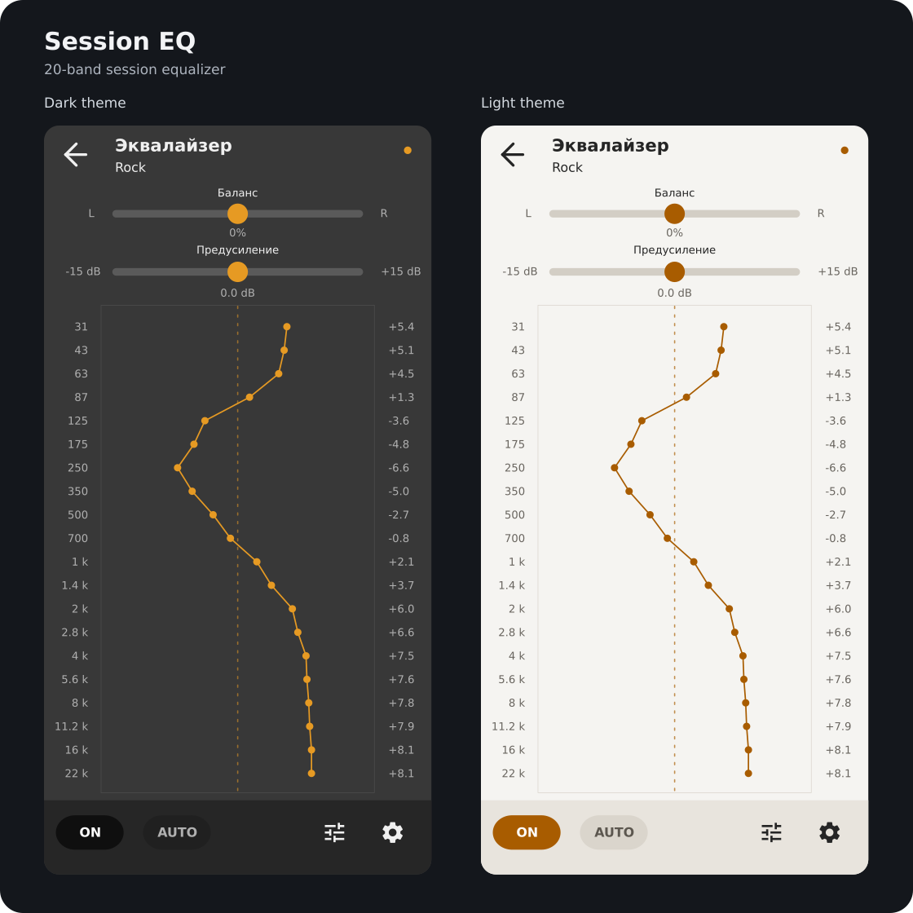

# Session EQ

An independent, open-source 20-band Android equalizer for audio sessions from
other music players. Inspired by the AIMP equalizer interface, implemented in
Java using Android DynamicsProcessing.



*Interface preview rendered from the app's layout, colors and Rock preset;
not a device screenshot.*

## Features

- 20 frequency bands, ±15 dB gain; balance and preamp.
- A curve with horizontally draggable band points and precise numeric input.
- Light/dark/system themes and adaptive icons with black sliders in an orange disk.
- Screenshot-based Rock, Flat, 24 separately labelled AIMP Windows presets,
  and saved user presets.
- ON/OFF, optional stereo-linked limiter, and AUTO preamp headroom compensation.
- A picker for currently playing apps, external-player effect-panel integration,
  session OPEN/CLOSE handling, and readable diagnostics. AIMP is excluded.
- Event-based status updates with no periodic background polling, wake locks,
  network access, microphone permission or Accessibility service.

## Compatibility and limitations

Android 9+ (API 28). Actual support depends on the device's DynamicsProcessing
implementation and the source player's audio output path. Creating an enabled
object does not by itself prove that every output is processed.

Start music, then choose Settings → Connect audio session in Session EQ and
select the player's name. The OFF button also opens this picker when no player
is connected. Selection enables the equalizer and connects the current streams
of that player; stale sessions are rechecked before attaching. No process or
audio-session ID entry is required.

### One-time player discovery access

Android does not expose the audio-session IDs of unrelated players through its
normal public playback list. On-demand discovery uses `Debug.dumpService` for
AudioService and requires the development permission `android.permission.DUMP`.
After installing the APK, grant it once using a computer with USB debugging:

```sh
adb shell pm grant dev.local.sessioneq android.permission.DUMP
```

The app explains this setup and offers to copy the command if access is missing.
It does not silently grant access. The scan runs only when opening/refreshing the
picker and rechecking a selection, on a worker thread. It reads only the audio
service dump into a private temporary cache file, deletes it immediately after
reading, and does not log or upload the dump. A process killed during that read
may leave a temporary cache file until cleanup. No notification-listener access,
root, microphone or network permission is required.

The dump format is device-dependent. Current active records are used; historical
playback events, invalid session IDs, other user profiles, calls/system tones,
ambiguous shared UIDs and AIMP are not offered. Package visibility is limited to
launcher applications plus AIMP for explicit exclusion; no QUERY_ALL_PACKAGES
permission is requested.

AIMP (`com.aimp.player` and its package variants) is rejected in discovery,
incoming OPEN requests, external-panel intents, session registry and native
attachment. An unknown owner is never guessed. This prevents ordinary AIMP
integration events from applying Session EQ on top of AIMP's own equalizer.

Players can also select Session EQ as their external effect panel and announce
their audio session directly. That integration does not require DUMP access.

A stopped background service may show a notification asking you to reconnect
when a new session arrives. Tap it to resume: Android restricts starting
foreground services from background receivers.

The original Rock values from the reference screenshot remain separate from
`AIMP Windows · Rock`. Equal numeric settings do not guarantee identical sound
to AIMP: the filter implementation and limiter differ.

**AUTO currently compensates preamp headroom.** It does not implement AIMP's
preset selection by track genre. It reduces input gain by the largest positive
band boost (including preamp), while preserving the displayed preamp value.

## Idle behavior

The settings screen uses a bound service. Native effects and a foreground
service are retained only while effects are attached and ON. OFF disables and
releases effects; closing the final audio session removes the started foreground
service. Closing an idle screen releases its bound service too.

A normal pause that keeps the audio session open retains the connection so music
can resume without manual reconnection. There are no recurring Session EQ Java
timers during that pause. If a player never sends CLOSE, use OFF or Stop service
for full cleanup. Battery savings have **not** yet been measured on hardware;
system audio processing must be considered separately from this app's process.

## Build

Requirements: JDK 17, Android SDK platform 35 and build-tools 35.0.0. The Gradle
8.10.2 wrapper is included; the application has no runtime library dependencies.

Set `ANDROID_HOME` to your SDK, or create an untracked `local.properties` file:

```properties
sdk.dir=/absolute/path/to/android-sdk
```

On Linux/macOS:

```sh
./gradlew verifyCore :app:assembleDebug
```

On Windows:

```powershell
.\gradlew.bat verifyCore :app:assembleDebug
```

APK output: `app/build/outputs/apk/debug/app-debug.apk`.
GitHub Actions runs the same checks and uploads the debug APK as a workflow
artifact. JVM checks cover EQ math, screenshot Rock values, session registry,
current-playback parsing and AIMP exclusion; Android discovery, audio lifecycle
and battery use still need device tests.

An alternative Linux SDK-tools build is available as `./build.sh`; it supports
`ANDROID_HOME`, `ANDROID_SDK_ROOT` or `SESSION_EQ_SDK`. Its APKs go into `dist/`.
Its development key is outside the repository, under
`~/.local/share/session-eq/debug.keystore`, unless `SESSION_EQ_SIGNING_KEY` is set.
This is a test key; choose separate private signing for public releases.

**An APK from another development key will not update an existing installation.**
Keep your signing key outside Git when producing updates. CI debug keys are
separate from the local key used for earlier personal builds.

## Development

See [CONTRIBUTING.md](CONTRIBUTING.md) and [AGENTS.md](AGENTS.md).
Do not commit APKs, SDK paths, credentials or signing keys. The original AIMP
archive is intentionally excluded; only numeric preset data, provenance and a
reproducible extraction script are retained.

## License and attribution

Original Session EQ code: [Apache License 2.0](LICENSE).
See [NOTICE](NOTICE) and [THIRD_PARTY_NOTICES.md](THIRD_PARTY_NOTICES.md) for icon
licenses and preset provenance. No AIMP source code or original application
binaries are included. Session EQ is not affiliated with or endorsed by AIMP.
